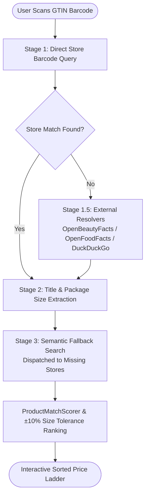
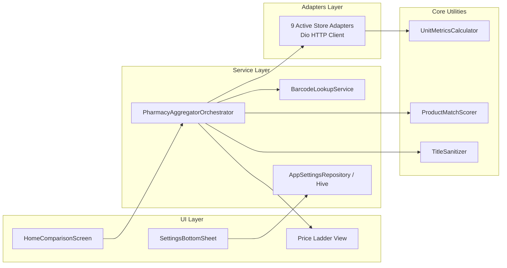

# Saudi Pharmacy & Beauty Price Aggregator

[](https://flutter.dev)
[](https://dart.dev)
[](LICENSE)
[](docs/TESTING_AND_RELIABILITY.md)
[](docs/TESTING_AND_RELIABILITY.md)

A high-performance cross-platform Flutter application engineered for real-time parallel price and promotion aggregation across 9 leading retail pharmacies and beauty marketplaces in Saudi Arabia.

---

## 🏬 Supported Store Roster

The application queries all 9 stores concurrently in real time:

| Store | ID | Channel | Specialization / Platform |
|---|---|---|---|
| **Al-Nahdi** (النهدي) | `al_nahdi` | Walk-In & Online | Saudi Arabia's largest pharmacy retail network |
| **United Pharmacy** (المتحدة) | `united_pharmacy` | Walk-In & Online | Nationwide community pharmacy chain |
| **Whites** (وايتس) | `whites` | Walk-In & Online | Health, beauty, and wellness retail chain |
| **Al-Dawaa** (الدواء) | `al_dawaa` | Walk-In & Online | Major retail chain (SAP Hybris) |
| **Boots KSA** (بوتس) | `boots` | Walk-In & Online | International health & beauty (SAP Commerce Cloud) |
| **Lemon Pharmacy** (صيدلية ليمون) | `lemon` | Walk-In & Online | Retail pharmacy network (Algolia engine) |
| **Nice One** (نايس ون) | `nice_one` | Online Marketplace | Cosmetics, skincare & fragrance platform |
| **Golden Scent** (قولدن سنت) | `golden_scent` | Online Marketplace | Luxury fragrances & beauty ecommerce |
| **Seoul House** (سيول هاوس) | `seoulhouse` | Online Specialist | Authentic Korean skincare (Shopify / Live SAR) |

---

## ⚡ Key Engineering Features

### 1. Progressive Non-Blocking Stream Architecture
- **Asynchronous Concurrent Lanes**: Dispatches parallel search requests across all 9 store adapters simultaneously using Dart `Stream<StoreSearchResult>`.
- **Sub-Second First-Contentful Lane**: Store results stream into the UI dynamically as individual HTTP responses resolve, eliminating aggregate blocking.
- **Resilient Failure Isolation**: Individual network timeouts (capped at 6s connect / 8s receive) or Cloudflare WAF challenges are isolated per lane without interrupting neighboring stores.

### 2. 4-Stage Bilingual Query Recovery (Damerau-Levenshtein + Google)
- **Keyboard-Aware Edit Distance**: Uses a custom physical key adjacency matrix (covering standard Arabic and QWERTY layouts) to correct aggressive fat-finger typos.
- **Arabic / English Cross-Language Recovery**: Seamlessly matches phonetically transliterated queries (e.g., `"سيتفايل غسلو"` $\rightarrow$ `"Cetaphil Cleanser" / "سيتافيل غسول"`).
- **Google Suggest / Translate Pre-Flight**: Fast zero-dependency semantic fallback pipeline for unrecognized search terms before dispatching adapter queries.

### 3. Decoupled 2-Stage Barcode Cascade

- **Silent Background Resolvers**: Background barcode-capable stores (`whites`, `boots`, `al_nahdi`, `lemon`, `seoulhouse`) resolve GTINs into canonical product titles even if disabled in user filters.
- **Package Size $\pm 10\%$ Tolerance Ranking**: Stage 3 semantic fallback matches prioritize offers matching the scanned product volume/weight (e.g. 473ml cream vs 118ml bottle).

### 4. Unit-Price Normalization
- Computes normalized pricing (e.g. **SAR per 100ml**, **SAR per 100g**, or **SAR per 10 tablets**) across varied package formats.
- Accurately decomposes multi-buy promo tiers (*"Buy 1 Get 1 Free"*, *"30% Off 2nd Item"*, *"Buy 2 for 45 SAR"*) to calculate true effective unit checkout cost.

---

## 🏛️ Architecture Overview



---

## 📚 Technical Documentation

Comprehensive architectural and engineering documentation is maintained in the [`docs/`](docs/) directory:

- [**System Architecture (`docs/ARCHITECTURE.md`)**](docs/ARCHITECTURE.md): Deep-dive into data contracts, sequence diagrams, and dependency structure.
- [**Security & Privacy Audit (`docs/SECURITY_AND_PRIVACY.md`)**](docs/SECURITY_AND_PRIVACY.md): OWASP mobile security evaluation, CVSS v4.0 scores, HTTPS enforcement, and local Hive data safety.
- [**Testing & Reliability Strategy (`docs/TESTING_AND_RELIABILITY.md`)**](docs/TESTING_AND_RELIABILITY.md): Verification methodology, mutation testing results, contract test suite, and chaos tests.
- [**Project Overview & Scope (`docs/PROJECT_OVERVIEW.md`)**](docs/PROJECT_OVERVIEW.md): Functional capabilities and product roadmap.
- [**Code Refactoring Plan (`docs/REFACTORING_PLAN.md`)**](docs/REFACTORING_PLAN.md): Technical debt management and directory organization.

---

## 🧪 Testing & Verification

The test suite enforces a strict **"Seen-to-Fail"** mutation testing policy to ensure assertions cannot pass vacuously.

```bash
# Run static analysis (0 warnings / 0 errors)
flutter analyze

# Run complete test suite (107/107 passing tests)
flutter test

# Run live command-line search reconnaissance
dart run bin/live_search.dart --query "Anua"
```

---

## ⚖️ Disclaimer

> Built as an experimental AI-assisted engineering portfolio project for educational purposes. Not affiliated with any listed retailers.
